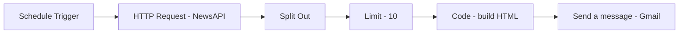

# 📰 Daily News Digest: n8n Workflow

An n8n workflow that fetches the latest articles on any topic from NewsAPI every morning, formats the top 10 into a single HTML email, and sends it to your inbox via Gmail. Wake up to a ready-made briefing instead of 20 open tabs.


## ✨ What it does

1. **Schedule Trigger** runs the workflow every day at 6 AM.
2. **HTTP Request** calls the NewsAPI `/everything` endpoint for your search topic (default: `bitcoin`).
3. **Split Out** turns the `articles` array into individual items.
4. **Limit** keeps only the first 10 articles.
5. **Code (JavaScript)** combines each article's title and content into one HTML string.
6. **Gmail** emails the digest to you.



## 🧩 Nodes used

| Node | Purpose |
|------|---------|
| **Schedule Trigger** | Starts the workflow daily at 6 AM |
| **HTTP Request** | Fetches articles from the NewsAPI REST endpoint |
| **Split Out** | Splits the `articles` array into separate items |
| **Limit** | Keeps the top 10 articles |
| **Code in JavaScript** | Merges the articles into one HTML email body |
| **Send a message** (Gmail) | Delivers the digest by email |

## 🔧 Requirements

- An [n8n](https://n8n.io) instance (cloud or self-hosted) that is running at the scheduled time
- A free **NewsAPI key** from [newsapi.org](https://newsapi.org/register)
- A **Gmail account** connected to n8n (OAuth2)

> ℹ️ NewsAPI's free Developer plan allows 100 requests per day and is intended for development and testing, with articles delayed by 24 hours. One request per day is well within the limit, but check [newsapi.org/pricing](https://newsapi.org/pricing) for current terms before using it in production.

## 🚀 Setup

1. **Import the workflow:** in n8n, go to **Workflows → Import from File** and select `workflow.json`.
2. **Add your NewsAPI key.** Open the **HTTP Request** node and replace the placeholder in the URL:
   ```
   https://newsapi.org/v2/everything?q=bitcoin&apiKey=YOUR_API_KEY
   ```
   A safer option is to remove `apiKey` from the URL and send it as a header instead, using a credential: set **Authentication → Generic Credential Type → Header Auth**, with the name `X-Api-Key` and your key as the value.
3. **Connect Gmail:** open the **Send a message** node and select your Gmail OAuth2 credential.
4. **Set the recipient:** change the `Send To` field to your own email address.
5. **Test it:** click **Execute workflow** and check your inbox.
6. **Go live:** activate the workflow. It will now run every day at 6 AM.

## ✏️ Customizing

- **Topic:** change `q=bitcoin` in the HTTP Request URL to any keyword, such as `q=AI`, `q=stock market`, or `q=your competitor`.
- **Newest first and English only:** add `&sortBy=publishedAt&language=en` to the URL for fresher, more consistent results.
- **Number of articles:** change **Max Items** in the Limit node.
- **Schedule time:** edit the Schedule Trigger. The trigger uses your n8n instance or workflow timezone, so set the timezone under **Workflow Settings** to make sure 6 AM means your 6 AM.
- **Links to full stories:** NewsAPI's `content` field is usually truncated, so add a link in the Code node:
  ```javascript
  let article = `<h2>${item.json.title}</h2>
    <p>${item.json.description || item.json.content}</p>
    <p><a href="${item.json.url}">Read full article</a></p><hr>`;
  ```
- **Email subject and heading:** edit them in the Gmail node. Make sure the heading tag is closed, for example `<h1>News Articles</h1>`.

## 🛡️ Recommended improvements

- **AI summaries:** add an AI Agent or LLM node to summarize each article in one or two lines before emailing.
- **Multiple topics:** run several searches and group the results by topic in one email.
- **Other channels:** send the digest to Slack, Telegram, or Discord instead of (or along with) email.
- **Error handling:** add an error workflow so you're alerted if the API call or email fails.

## 📁 Repo structure

```
.
├── workflow.json      # Importable n8n workflow
├── screenshots/       # Canvas screenshots
└── README.md
```

## 🔐 Security note

Never commit your NewsAPI key to a public repo. Make sure `workflow.json` contains a placeholder instead of a real key, and remove your personal email address and credential IDs before pushing. If a key was ever committed, regenerate it on newsapi.org, because it stays in the git history even after you delete it.


## 📄 License

MIT. Feel free to use, modify, and share.

---

